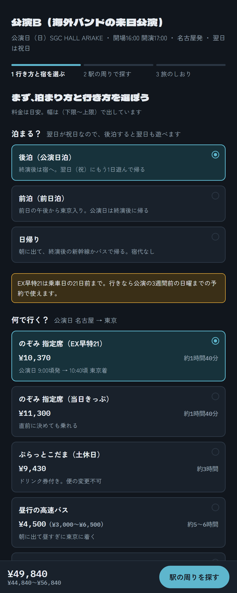

# 推し活遠征プランナー（仮称） — ensei-support

[](https://github.com/supernova2005y/ensei-support/actions/workflows/ci.yml)
[](LICENSE)


ライブの予定から、交通・宿・寄り道を組み合わせた**旅のしおりと総額**を出す、推し活遠征のためのアプリを作っています。
いまは**API連携の段階**です。企画・調査・試作（HTML）を終え、Next.js のアプリで、帰りの最終便に間に合うかの判定と、楽天トラベルの空室を宿のグレード別に出すところまでできています。

| アプリ（`npm run dev`） | 試作（HTML。ブラウザで開くだけ） |
|---|---|
|  |  |

※ 公演名・日付はぼかしたサンプルです（「公演B」・2026-12-13）。宿の空室は、楽天のキーを入れて「空室を探す」を押すと出ます。

公開版（[ensei-support.vercel.app](https://ensei-support.vercel.app/)）で「空室を探す」を押したところ：


※ 宿ごとの名前・料金・口コミは、楽天のデータなので塗りつぶしています（2026-11-24 撮影）。

## このリポジトリで見てほしいところ

見どころは「何を作るか」を、作る前にどう確かめたかです。

| 段階 | やったこと | ファイル |
|---|---|---|
| 課題を見つける | 名古屋から遠征する当事者として、調べものが複数のサイトに散らばっていて面倒なことに気づいた | `docs/企画書.md` の2章 |
| 似たサービスを調べる | 直接の競合・大手のAI旅行プランナー・撤退した事例まで調べ、同じことをするサービスがないことを確認 | `research/01_competitors.md` |
| 作れるかを調べる | 宿・電車・店などのAPIの機能・料金・規約を比較し、APIがない部分（高速バス・展覧会）を洗い出した | `research/02_apis.md` |
| 実際の旅で試す | 過去の公演で、AIが出した旅程と自分の実際の旅程を比べ、見落とし（途中駅で降りる、など）を設計に戻した | `research/03_dryrun_live_a.md` |
| 画面を絞る | 一問一答・3案比較など4つの案を試作し、「選ぶ → 駅の周りで探す → しおり」の3画面に決めた | `prototype/plan-flow-live-b.html`（最新） |
| データの形を決める | API につなぐ前に、公演・交通・宿・立ち寄り先の形を決め、試作の値を JSON に書き出した。各項目をどの API から取るかも対応づけた | `docs/データの形.md`、`events/live-b.json`、`data/live-b.json` |
| API につなぐ | 楽天の空室を料金の切れ目で4グレードに分けて画面に出した。交通・お店の API は単体で叩いて、返ってくる中身を確かめた | `src/`、`scripts/`、`research/05_rakuten_vacant_live_b.md` |

## 技術スタック

| カテゴリ | 使っているもの |
|---|---|
| アプリ | Next.js 16（App Router）・React 19・TypeScript 5.9 |
| 実行環境 | Node.js 22.18 以上（テストは `node --test` で `.ts` をそのまま動かす） |
| 外部 API | 楽天トラベル（空室検索。アプリの画面で使用）、NAVITIME（RapidAPI）・ホットペッパーグルメ・Google Places（確認用スクリプトまで） |
| データ | JSON ファイル（`events/` に公演の設定、`data/` に試作の値と最終便の表）。データベースは使わない |
| API キー | サーバー側（`/api/stays`）だけで使う。`.env` に置き、Git には載せない |
| テスト・CI | `node:test`（API は呼ばず、手作りのデータでテスト）、GitHub Actions（typecheck・test・build） |
| 公開 | Vercel（手順は `docs/vercel-setup.md`） |
| 開発 | Claude Code |

## はじめ方（起動のしかた）

### すぐ試す（公開版）

[ensei-support.vercel.app](https://ensei-support.vercel.app/) を開くだけで使えます。インストールもキーの登録も要りません。
公演を選んで「空室を探す」を押すと、楽天トラベルの空室が宿のグレード別に出ます。

- 空室検索の回数には上限があります（1人あたり1分に1回・1日10回、全体で1日200回）
- 公開版は `main` に入ったコードから作られます

### 手元で動かす（コードを直す人向け）

コードを書き換えて確かめたいとき、テストを動かすとき、楽天以外の API を試すときは、こちらです。

必要なもの：Node.js 22.18 以上、npm。

※ Windows の PowerShell で「スクリプトの実行が無効」と出て止まったら、`npm` の代わりに `npm.cmd`（例：`npm.cmd ci`）と打つか、コマンド プロンプトで実行してください。

```bash
git clone https://github.com/supernova2005y/ensei-support.git
cd ensei-support
npm ci                 # 依存を入れる
npm test               # テスト（API は呼ばない）
npm run dev            # アプリ → http://localhost:3000/
```

- **キーがなくても動くもの**：公演の一覧（`/`）、公演の画面（`/events/live-b`）、帰りの最終便に間に合うかの判定
- **楽天のキーが要るもの**：公演の画面の「空室を探す」。`.env.example` を `.env` にコピーして `RAKUTEN_*` を入れる（取得先は `.env.example` に書いてある）
  - `.env` は Git に載らないので、作ったパソコンにしか残らない。キーの値はパスワード管理アプリにも控えておく（Vercel の値は Sensitive なので、あとから見られない）
- **試作の HTML**：`prototype/plan-flow-live-b.html` をブラウザで開くだけで動きます（データは固定の値。サーバーは要らない）

ほかのコマンド：

| コマンド | すること |
|---|---|
| `npm run typecheck` | 型のチェック |
| `npm run build` → `npm run start` | 本番用にビルドして起動（`http://localhost:3000/`） |
| `node scripts/rakuten-vacant.mjs --event events/live-b.json` | 楽天の空室検索を単体で叩く（要キー） |
| `node scripts/navitime-route.mjs` など | 交通・お店の API を単体で叩く確認用スクリプト（要キー。使い方は各ファイルの先頭） |

公演を足すときは、`events/` に JSON を1つ置きます（形は `docs/データの形.md`）。

## ドキュメント

| ファイル | 内容 |
|---|---|
| [`docs/企画書.md`](docs/企画書.md) | 何を作るか：一言・背景・3画面・設計の原則・差別化・未決事項 |
| [`docs/開発のTODO.md`](docs/開発のTODO.md) | 開発のロードマップ（フェーズごとのチェックリスト） |
| [`docs/データの形.md`](docs/データの形.md) | アプリが扱うデータの形（`events/` と `data/` の分担）と、どの API から取るか |
| [`docs/vercel-setup.md`](docs/vercel-setup.md) | Vercel で公開する手順（キーの入れ方、エラーのときの直し方） |
| [`docs/google-places-setup.md`](docs/google-places-setup.md) | Google Places API のキー・予算アラート・1日の上限の設定手順 |

## ファイル一覧

| ファイル | 内容 |
|---|---|
| `research/01_competitors.md` | 競合調査 |
| `research/02_apis.md` | API調査（機能一覧・料金比較・規約） |
| `research/03_dryrun_live_a.md` | 試走①：公演A・10月の土曜（過去の公演・実際の旅程との比較） |
| `research/04_test_live_b.md` | 試走②：公演B・11月の日曜（未来の公演） |
| `research/05_rakuten_vacant_live_b.md` | 楽天空室検索APIの初回実行（公演B・11月の日曜）と試作の推定との比較 |
| `research/06_reference_articles.md` | 交通API を選ぶときに読んだ個人開発の記事のまとめ（参考にできる点つき） |
| `research/07_ui_feedback.md` | 公開した画面へのフィードバックと対応（反映したもの・保留中のもの） |
| `research/08_test_live_c.md` | 試走③：公演C・1月の土曜・大阪（東京以外の会場で初めて。日帰りの判定と最終便の表の広げ方） |
| `prototype/plan-flow-live-b.html` | **最新の試作**（3画面、泊まり方の選択つき） |
| `prototype/plan-flow-live-a.html` | 3画面の初版 |
| `prototype/plan-live-a.html` / `plan-compare-live-a.html` | 不採用になった案（v1〜v3） |
| `src/` | Next.js のアプリ本体（`src/app/` 画面とAPI、`src/lib/` 楽天の呼び出し・グレード分け・最終便の判定） |
| `events/live-b.json`・`live-c.json` | 公演ごとの設定（会場の座標、日付、会場へ行きやすい駅と乗車時間の目安、帰りの乗車駅） |
| `data/live-b.json` | 公演Bの試作データを、`docs/データの形.md` の形で書き出したもの |
| `data/last-trains.json` | 主な区間の最終便の表（AIのWeb検索などで下書きし、人が公式の時刻表で確かめる） |
| `scripts/rakuten-vacant.mjs` | 楽天トラベル空室検索APIを単体で叩き、会場と行きやすい駅の周りの空室を4グレードに振り分けて表示する（生のJSONは `out/` に保存） |
| `scripts/navitime-route.mjs` | NAVITIME ルート検索（RapidAPI）で、行きやすい駅・出発地から会場までの所要時間と運賃を表示する |
| `scripts/last-train.mjs` | 終演後に帰りの最終便に間に合うかを判定（API は呼ばない。最終便の表と会場→乗車駅の時間を使う） |
| `scripts/hotpepper-shops.mjs` | ホットペッパーグルメAPIで、会場と駅の周りのお店と、公演の曜日が定休日かもしれない印を表示する |
| `scripts/google-places.ts` | Google Places API で駅の周りのパン屋・洋菓子店などを探し、公演の日に開いているかを判定する（呼び出し回数を数えて上限で止まる） |
| `tools/extract_prototype_data.mjs` | 試作 HTML から JSON を書き出し、形を確かめるスクリプト |
| `.env.example` | APIキーの項目一覧（`.env` にコピーして使う） |

## ライセンス・権利について

- コードと文章は [MIT License](LICENSE) です
- アーティスト・会場・各サービスとは関係のない、非公式の個人開発です。施設名・イベント名などの名前やデータの権利は、それぞれの権利者にあります
- 宿の空室・料金は楽天トラベルの情報です（Supported by Rakuten Developers）
