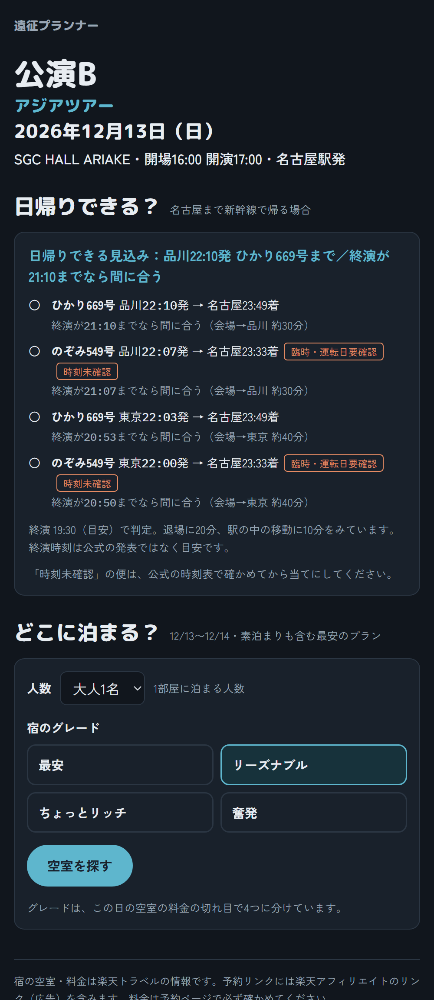
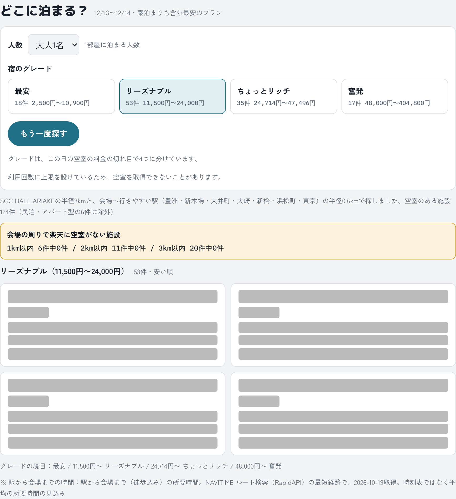

# ライブ遠征プランナー

[](https://github.com/supernova2005y/ensei-support/actions/workflows/ci.yml)
[](LICENSE)


ライブの予定から、泊まり方（日帰り・前泊・後泊）を選び、駅の周りの店を探し、交通・宿・寄り道を組み合わせた**旅のしおりと総額**を出すアプリです。
AIに旅行計画を丸投げするのではなく、**複数の情報源のデータを1つの旅程にまとめ、確かな情報と未確認の情報を区別して、本人が納得して選べる**ようにすることを目指しています。

| アプリ（Next.js） | 画面の試作（HTML） |
|---|---|
|  |  |

※ 公演名・日付はぼかしたサンプルです。宿の空室検索には楽天の API キーが要ります。

公開版（[ensei-support.vercel.app](https://ensei-support.vercel.app/)）で「空室を探す」を押したところ：



※ 宿ごとの名前・料金・口コミは、楽天のデータなので塗りつぶしています（2026-11-24 撮影）。

**このプロジェクトのポイント**
1. **当事者として課題を見つけ、企画した** — 名古屋から遠征する中で感じた不便を、実測で裏づけた（[なぜ作るか](#なぜ作るか)）
2. **実際の遠征で仮説を確かめ、設計に戻した** — 公演3件で試し、5つの思い込みを直した（[仮説の検証](#仮説の検証と設計への反映)）
3. **AIを使いながら、APIの制約と情報の正確さまで考えて実装した** — 最終便の判定・宿のグレード分け・未確認の表示（[技術的な工夫](#技術的な工夫)・[AIの使い方](#aiの使い方)）

## なぜ作るか

遠征の計画は楽しい一方、交通・宿・寄り道を別々のサイトで調べる手間があります。さらに、**宿が高く、埋まりやすいのは「公演のある夜」の「会場の近く」だけ**なので、どこに・どの夜に泊まるかで払う額が大きく変わります。楽天トラベルの空室検索で、首都圏の会場の公演1件（1名1泊・会場から半径3km）を、日付と場所を変えて比べてわかりました。

- **公演のある夜**：同じ施設でも、公演のない翌週の週末の**約2倍**（同じ施設どうしの中央値 1.8〜1.9倍、最大3.6倍）
- **会場の近く**：公演の夜、会場から1km以内の宿は**6件中4件が空室なし**。会場へ電車で行きやすい駅の周りまで広げると、空室のある宿は18件から93件に増え、1万円を切る宿もあった
- **公演のない夜**：同じ旅行でも、公演の翌日の夜（連泊の2泊目）は**ほぼ普段の料金**（中央値 1.0倍）

→ 汎用の旅行プランではなく、**公演日・終演時刻・最終便・宿の高騰といった遠征に特有の制約**を前提に、選ぶのを手伝うことに絞りました。旅行会社の推し活向けプランは自社の在庫の中での提案で、AI旅行プランナーはこうした制約を前提にしていません（[競合調査](research/01_competitors.md)）。予約は自社で持たず、予約サイトへの送客にとどめます（在庫と前受金のリスク・旅行業法のため）。

## 仮説の検証と設計への反映

実装に入る前に、過去・未来の公演3件で、実際の遠征に当てはめて試しました。

| 仮説 | 試してわかったこと | 設計への反映 | 記録 |
|---|---|---|---|
| 寄り道は会場の周りで探せばよい | AIが作った旅程を、自分が実際に行った旅程と比べると、「新幹線を途中駅で降りる」「帰りの出発駅の周りで探す」が抜けていた | 寄り道は**乗り降りする駅を起点に**探す | [試走①](research/03_dryrun_live_a.md) |
| 泊まるのは公演の夜でよい | 翌日が祝日かどうかで、いちばん良い泊まり方が変わった | 日帰り／前泊／後泊を選べるようにする | [試走②](research/04_test_live_b.md) |
| 宿の料金は推定で足りる | 推定は実際より2〜3.5倍安かった | 楽天の実データを使う | [楽天の実測](research/05_rakuten_vacant_live_b.md) |
| 宿のグレードは件数で4等分すればよい | 1万円台と3万円台の宿が同じグレードに入った | 料金の分布の切れ目で分ける（下の「技術的な工夫」） | 同上 |
| 最終便の表は東京の分があればよい | 大阪の公演では使えなかった | 区間ごとに表を足す → [今後の課題](#いまの状況と今後の課題)へ | [試走③](research/08_test_live_c.md) |

**画面も4つの案を試作して比べました**（[`prototype/`](prototype/)）。一問一答は、ある問いに答えるにはほかの問いの答えが先に要るのに、順番が固定で前の答えを直せませんでした。旅程を3案並べる形は、交通・宿・寄り道がセットで固定され、組み合わせを変えられませんでした。そこで「① 選ぶ → ② 駅の周りで探す → ③ しおり」の3画面にしました。①で条件を選び直すと、総額がその場で変わります。

## 技術的な工夫

### 1. 帰りの最終便に間に合うかの判定（[`src/lib/lastTrain.ts`](src/lib/lastTrain.ts)）

時刻表 API に頼らず、最終便の表と「会場から乗車駅までの時間」から判定します。大阪の公演に名古屋から日帰りする場合の例です。

**前提（公演・人によって変わる情報）**

| 項目 | 例の値 |
|---|---|
| 終演の目安 | 20:15 |
| 会場 → 乗車駅（新大阪）の移動 | 25分（徒歩＋地下鉄） |
| 退場にかかる時間（会場の混雑の目安） | 20分 |
| 帰りの最終便 | 新大阪 22:30発 |
| 駅の中の移動（改札 → ホーム） | 10分（どの公演でも同じ） |

**判定**：最終便の発車時刻から、駅の中の移動・会場からの移動・退場の時間を引いて、「終演がこの時刻までなら間に合う」を求めます。

```
22:30 − 10分 − 25分 − 20分 ＝ 21:35 までに終演すれば間に合う
終演の目安 20:15 は 21:35 より前 → 日帰りできる（余裕は1時間20分）
```

- 結果は **日帰りできる／臨時列車なら間に合う／間に合わない** の3つ。終演は公式に発表されないことが多いので、「何時までに終われば間に合うか」を表示します。終演の目安との差が、そのまま余裕の大きさになります
- 会場から乗車駅までの時間がわからない駅は、**推測せず「判定できない」と表示します**。人が公式の時刻表などで確かめていない便には、印を付けます
- 今後：退場にかかる時間を、会場の規模で変える予定です（ドーム・スタジアム45分／アリーナ30分／ホール20分／ライブハウス15分。いずれも未確認の目安で、いまは公演ごとに手で入れている）

### 2. 料金の分布に合わせた宿のグレード分け（[`src/lib/stays.ts`](src/lib/stays.ts) の `naturalBreaks`）

公演日に実際に払う料金で、最安／リーズナブル／ちょっとリッチ／奮発の4つに分けます。

- **Jenks の自然分類**（1次元の最適な k-means）をもとにしています。安い順に並べた料金を、グループ内のばらつき（二乗誤差）の合計が最小になるように区切り、その区切りを**動的計画法**で厳密に求めます
- 宿の料金は倍々で開くので、**対数をとってから**分けます
- 標準の方法に、**各グレードに最低でも全体の15%を入れる制約**を足しました（切れ目だけだと「最安8件・リーズナブル44件」のように偏ったため）
- 評価の高さでは絞りません。楽天の評価は「値段のわりにどうか」も含むので、高級なホテルほど低めに出るためです

### 3. API の選び方と、API がない情報の扱い

選ぶ基準は、①個人で登録できるか ②料金・無料枠 ③必要な項目を返すか ④規約（キャッシュ・収益化の制限）です（[API 調査](research/02_apis.md)）。

| 用途 | API | 現状 |
|---|---|---|
| 宿 | 楽天トラベル（空室・料金・評価・アフィリエイトリンクを一度に取れる） | アプリにつないだ |
| 交通 | NAVITIME（RapidAPI。新幹線の運賃と特急料金を分けて返す） | 未実装。無料枠の上限を数える仕組みを準備中 |
| 飲食店 | ホットペッパーグルメ | 寄り道の画面で、駅の周りの店を検索 |
| 周辺の施設 | Google Places（営業状態が取れる） | 未実装。課金の設定が必要なため |

高速バス・展覧会・公演情報・最終便の時刻には、使える API がありません。出典つきの Web 検索や、手で作った表で扱います。その際、**未確認の情報を確かな情報として表示しない**ようにしています（人が確かめたら表の `verified` を true にする。確かめていないものは画面に「要確認」と表示する）。

## AIの使い方

開発には Claude Code を使っています。

| AI に任せたこと | 自分でしたこと |
|---|---|
| コードの実装・テスト | 当事者としての課題の発見と企画 |
| 競合・API の調査（出典つき） | 自分の実際の旅程を出し、AIの旅程との違いを見つける |
| 画面の試作 | 公開した画面をスマホで見て、直す点を出す（[画面への意見](research/07_ui_feedback.md)） |
| 最終便の表の下書き（Web 検索） | 最終便の時刻を、手元の乗換検索で確かめる |
| 設計の案を比べて並べる | 案の中から、どれを採るかを決める／API のアカウント登録 |

AIの出力はそのまま使わず、**出典と、人が確かめたかどうかを記録**します。特に最終便のように、間違えると帰れなくなる情報は、未確認であることをはっきり表示します。

## いまの状況と今後の課題

**できていること**：帰りの最終便の判定画面、楽天の空室を4グレードで出す画面、寄り道の3画面。
宿の決定の流れ（この宿にする・ホステル/ゲストハウスの除外・前泊）、駅の周りの店の検索。

**課題1：旅程全体のつじつまを確かめられるデータの形がまだない。** 交通・宿・最終便がそれぞれ別の形で、「日帰りと後泊、どちらが成り立って、いくらか」を同じ条件で比べられません。次の順番で作ります。

1. 交通を、出発・到着・時刻・料金の幅・出典・人が確かめたかを持つ**区間**の形にそろえる（交通が、乗り降りする駅と空き時間を決める旅程の骨組みなので最初にやる）
2. 交通・宿・公演の**つじつまを確かめる仕組み**を作る（乗り継ぎがつながるか、宿の日付と合うか、開場と終演後の便に間に合うか。結果は OK・NG・未確認）
3. 泊まり方と交通手段の**組み合わせごとに、成り立つかと総額を並べる**
4. 決まった駅と空き時間に合わせて、寄り道を提案する

**課題2：正しいと言える範囲が、まだ自分の遠征3件（名古屋発・東京と大阪の会場）に限られている。** 最終便の表は2区間だけで、人が確かめた便は4本中1本です。公演情報にも安定したデータ源がありません。まず地方から東京・大阪への遠征に対象を絞って正確さを上げ、その後、推し活仲間でβテストをします。

ロードマップの細かい項目は [`docs/開発のTODO.md`](docs/開発のTODO.md)。

## 技術スタック

| カテゴリ | 使っているもの |
|---|---|
| アプリ | Next.js 16（App Router）・React 19・TypeScript 5.9 |
| 実行環境 | Node.js 22.18 以上 |
| 外部 API | 楽天トラベル・NAVITIME（RapidAPI）・ホットペッパーグルメ・Google Places |
| データ | JSON ファイル。API キーはサーバー側だけで使う。（使用回数を数えるために Upstash を使う予定） |
| テスト・CI | `node:test`（本物の API は呼ばない）・GitHub Actions（typecheck・test・build） |
| 公開 | Vercel |
| 開発の支援 | Claude Code |

## はじめ方（起動のしかた）

### すぐ試す（公開版）

[ensei-support.vercel.app](https://ensei-support.vercel.app/) を開くだけで使えます。インストールもキーの登録も要りません。
公演を選んで「空室を探す」を押すと、楽天トラベルの空室が宿のグレード別に出ます。

- 空室検索の回数には上限があります（1人あたり1分に1回・1日10回、全体で1日200回）
- 公開版は `main` に入ったコードから作られます

### 手元で動かす（コードを直す人向け）

コードを書き換えて確かめたいとき、テストを動かすとき、楽天以外の API を試すときは、こちらです。

必要なもの：Node.js 22.18 以上、npm。

※ Windows の PowerShell で「スクリプトの実行が無効」と出て止まったら、`npm` の代わりに `npm.cmd`（例：`npm.cmd ci`）と打つか、コマンド プロンプトで実行してください。

```bash
git clone https://github.com/supernova2005y/ensei-support.git
cd ensei-support
npm ci                 # 依存を入れる
npm test               # テスト（API は呼ばない）
npm run dev            # アプリ → http://localhost:3000/
```

- **キーがなくても動くもの**：公演の一覧（`/`）、公演の画面（`/events/live-b`）、寄り道の3画面（店の検索を除く）
- **楽天のキーが要るもの**：公演の画面の「空室を探す」。`.env.example` を `.env` にコピーして `RAKUTEN_*` を入れる（取得先は `.env.example` に書いてある）
  - `.env` は Git に載らないので、作ったパソコンにしか残らない。キーの値はパスワード管理アプリにも控えておく（Vercel の値は Sensitive なので、あとから見られない）
- **ホットペッパーのキーが要るもの**：寄り道の画面の「駅の周りの店を探す」。`HOTPEPPER_API_KEY` を入れる（`.env.example` に項目があります）
- **試作の HTML**：`prototype/plan-flow-live-b.html` をブラウザで開くだけで動きます（データは固定の値。サーバーは要らない）

ほかのコマンド：

| コマンド | すること |
|---|---|
| `npm run typecheck` | 型のチェック |
| `npm run build` → `npm run start` | 本番用にビルドして起動（`http://localhost:3000/`） |
| `node scripts/rakuten-vacant.mjs --event events/live-b.json` | 楽天の空室検索を単体で叩く（要キー） |
| `node scripts/navitime-route.mjs` など | 交通・お店の API を単体で叩く確認用スクリプト（要キー。使い方は各ファイルの先頭） |

公演を足すときは、`events/` に JSON を1つ置くだけです（形は `docs/データの形.md`）。寄り道の候補のファイル（`data/`）は、必要なときだけ作ります。

## 関連ドキュメント

- [`docs/企画書.md`](docs/企画書.md)：企画の背景・3画面・設計の原則・差別化
- [`docs/開発のTODO.md`](docs/開発のTODO.md)：開発のロードマップ
- [`docs/データの形.md`](docs/データの形.md)：データの形と、どの API から取るか
- [`docs/API規約メモ.md`](docs/API規約メモ.md)：API の規約（ホットペッパー）の確認状況と、問い合わせの下書き
- [`research/`](research/)：競合調査・API 調査・実際の遠征での検証の記録

## ライセンス・権利

- コードと文章は [MIT License](LICENSE) です
- アーティスト・会場・各サービスとは関係のない、非公式の個人開発です
- 宿の空室・料金は楽天トラベルの情報です（Supported by Rakuten Developers）
